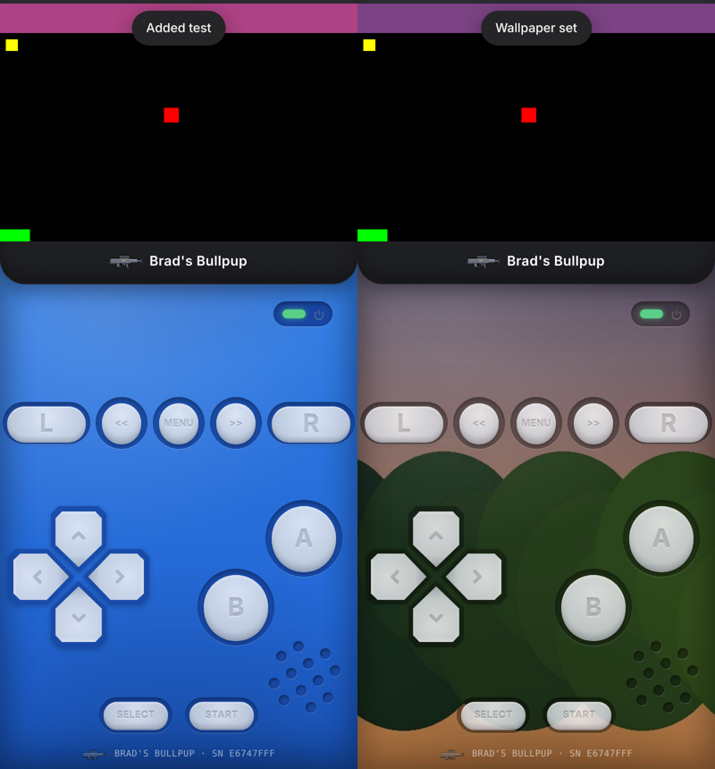
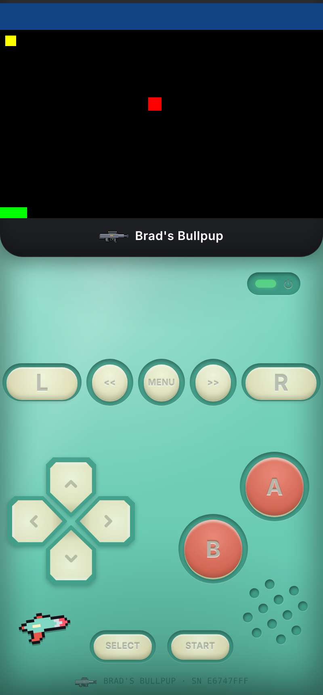

# Brad's Bullpup

A Game Boy Advance, Game Boy and Game Boy Color emulator for Android that I built to replace Pizza Boy A Pro on my phone. The whole app is one offline HTML file running the mGBA core in WebAssembly, wrapped in a tiny native WebView shell. The APK is about 430 KB.

<p>


</p>

No games are included. Load ROMs you dumped from cartridges you own.

## Install

Download [Brads_Bullpup_1.4.apk](release/Brads_Bullpup_1.4.apk?raw=1) on your phone, open it and allow installs from your browser or file manager if Android asks. Play Protect may warn about an unknown developer, since it isn't from the Play Store. Tap "Install anyway".

There's also [Brads_Bullpup_1.4.html](release/Brads_Bullpup_1.4.html?raw=1), the same app as one file you can open in Chrome on a phone or PC.

It runs on Android 7 and up. New versions install over old ones and keep your games, saves and states, as long as they're signed with the same key. 1.4 is signed with a new key, so coming from 1.3 you need to export a backup in System, uninstall 1.3, install 1.4 and import the backup. Later versions will update over 1.4 normally.

## What it does

Emulation is mGBA, one of the most accurate GBA emulators around. On top of that:

- Save states in 9 slots with screenshots, an auto snapshot when you leave a game, and undo for the last save or load
- Rewind (hold the << button), fast forward up to 12x, and slow motion where the audio slows down with it
- In-game saves stored on the phone automatically, plus .sav import and export so you can move saves from Pizza Boy, My Boy or mGBA
- Cheats in Raw, CodeBreaker, GameShark v1/v2 and Action Replay v3 formats
- A RAM search for finding your own cheats: note your health, take a hit, filter by the new value, lock it
- IPS, UPS and BPS patches for ROM hacks and translations
- Screen shaders (LCD grid, subpixels, scanlines, CRT, DMG green), GBA colour correction and frame blending
- Audio effects: reverb with 6 rooms, a 3-band EQ, stereo width and a handheld speaker mode
- Gamepad and keyboard remapping, turbo buttons, and a touch layout editor with separate portrait and landscape layouts
- Screenshots and video clip recording, saved to Downloads/Bullpup. Clips are MP4 (H.264 and AAC) on phones that can encode it, so they send straight to WhatsApp, and WebM otherwise
- A backup file with all saves, states, cheats and settings

The Look tab is where I spent the most time. There are 11 controller skins, 5 button styles, an iOS-style light theme, click sounds and vibration levels, and a power LED that changes colour for fast forward, rewind and recording. You can also use a photo as the body of the controller. With Vinyl wrap on, it's printed on like a skin: the picture rolls over the sides and bottom of the body and stretches down into each button well, lit to match the Finish setting. That's baked into a canvas once per layout, so it costs nothing while you play. Six optional green lights next to the power LED fill up as the next auto snapshot gets closer, and the button opacity slider goes down to 5%. The pixel weapons (bullpup, pistol, revolver, ray gun, water blaster, sniper and a bubble blaster) show up as stickers, a body pattern and placeholder covers.

## How it's put together

```
web/          the app: shell.html, app.css, js/ (loaded in filename order)
web/brand/    the pixel bullpup and sprite sheet, plus the Python that draws them
vendor/mgba/  mgba.js and mgba.wasm, unchanged (see SOURCE.md)
android/      manifest, icons and MainActivity.java for the WebView shell
tools/        bundle.py and build_apk.sh
test/         a homebrew test ROM, its C source, and a Playwright end-to-end test
dist/         the bundled single-file app
release/      signed APKs and HTML builds, one per version
```

The core is the single-threaded mGBA build from the wasm-gaming project, so it doesn't need SharedArrayBuffer or special server headers. That is what lets it run from a plain file or inside a WebView.

Two tricks are worth explaining because they're not obvious from the code.

Cheats and RAM search need to read and write emulated memory, and the core doesn't export a pointer to it. So when a GBA game loads, I save a state, plant a random 16-byte marker in the work RAM section of that state, load it back and search the wasm heap for the marker. That gives the heap address of the emulated RAM. The original bytes are put back before a single frame runs.

In-game saves had a nastier problem. mGBA only restores save data once it knows the cartridge's save type, and for games outside its override database it works that out the first time the game touches save memory, which is after the game has already read its save. My fix reads the save type from the size of the stored .sav, writes it into byte 0x2E0 of a save state (the savedata type field) and loads that state before the first frame. I checked the layout against mGBA's serialize.h at the pinned commit, so if the core is ever updated this offset needs checking again.

The Android side is a single activity. It serves the page from https://appassets.androidplatform.net/ through shouldInterceptRequest, which gives the page a secure origin so IndexedDB, AudioWorklet and crypto behave the way they do in Chrome. It also handles the file picker and a small JavaScript bridge that writes exports to Downloads/Bullpup.

## Building it yourself

```
python3 tools/bundle.py          # web/ + vendor/ -> dist/Brads_Bullpup.html
./tools/build_apk.sh             # dist/ -> dist/Brads_Bullpup.apk
```

The APK build doesn't need Android Studio. It downloads aapt2, android.jar, d8, ecj and apksigner from two npm packages into .toolchain/ and needs Java 17 or newer, Node and Python 3. I compile with ecj instead of javac because d8 8.2 rejects the MethodParameters attribute that newer javac versions write into inner classes.

Without signing settings the script makes a new key in keys/, which is git-ignored. To sign with your own key, set KEYSTORE, KS_PASS and KS_ALIAS. My release key isn't in this repo.

To run the tests (Playwright with Chromium):

```
python3 test/e2e.py
```

They boot the test ROM, check touch input, RAM search, all three cheat formats, save states, rewind, fast forward and that in-game saves survive a reload.

## What's missing

Tilt and solar sensors, rumble, link cable play and RetroAchievements aren't supported. Cheats only reach work RAM, so codes that patch the ROM are skipped. Cheats and RAM search are GBA only.

The automated tests run a homebrew ROM in headless Chrome. It hasn't been tried across a wide range of phones and games, so expect some where something is off. Open an issue with the game, the phone model and what you see.

## Credits and licence

Emulation is [mGBA](https://github.com/mgba-emu/mgba) by Jeffrey Pfau and contributors, built for the web by [wasm-gaming/mGBA-wasm](https://github.com/wasm-gaming/mGBA-wasm). Cheat code formats follow VBA-M's gbaCheats.cpp. The test ROM is built with libtonc.

Released under the Mozilla Public License 2.0, the same licence as mGBA.
